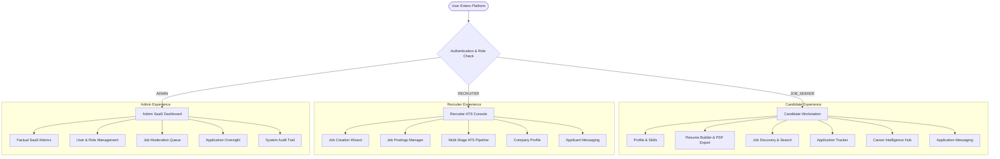
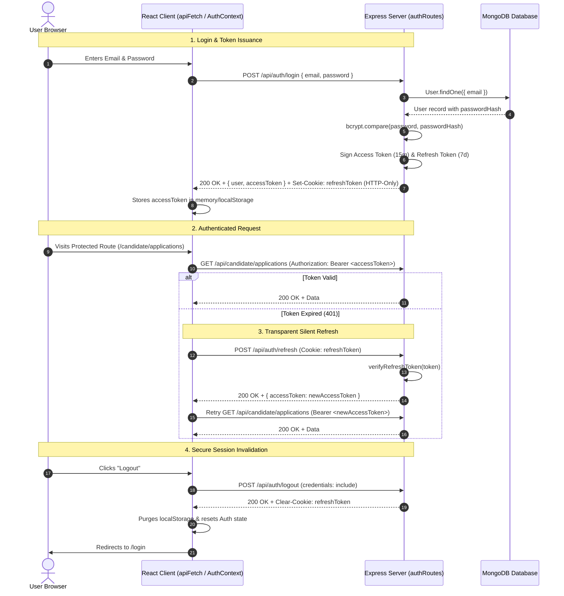

# JobPortal 2.0 — Production-Grade MERN Recruitment & Career Intelligence Platform

[](https://nodejs.org/)
[](https://expressjs.com/)
[](https://react.dev/)
[](https://vitejs.dev/)
[](https://www.mongodb.com/)
[](https://opensource.org/licenses/ISC)
[](test_verification.js)

A modern, full-stack recruitment platform inspired by the professional usability of Naukri.com. Engineered with the MERN stack (MongoDB, Express 5, React 19, Node.js), JobPortal 2.0 provides three distinct role-based experiences for **Job Seekers / Candidates**, **Companies / Recruiters**, and **Platform Administrators**.

The application features authoritative dual-token JWT authentication with silent session refresh, a multi-stage Applicant Tracking System (ATS), structured resume management with vector A4 PDF export, application-linked messaging, and four 100% deterministic, explainable intelligence engines for career planning and job discovery.

---

## Table of Contents

- [1. Project Purpose & Highlights](#1-project-purpose--highlights)
- [2. Technology Stack](#2-technology-stack)
- [3. Three Role-Based Workspaces](#3-three-role-based-workspaces)
  - [Candidate / Job Seeker](#a-candidate--job-seeker-workspace)
  - [Company / Recruiter](#b-company--recruiter-workspace)
  - [Platform Administrator](#c-platform-administrator-console)
- [4. Core Feature Matrix](#4-core-feature-matrix)
- [5. Intelligence Engines (Deterministic & Explainable)](#5-intelligence-engines-deterministic--explainable)
- [6. Authentication, Authorization & Security Architecture](#6-authentication-authorization--security-architecture)
- [7. System Architecture & Directory Structure](#7-system-architecture--directory-structure)
- [8. Prerequisites & Software Requirements](#8-prerequisites--software-requirements)
- [9. Step-by-Step Local Installation](#9-step-by-step-local-installation)
  - [Environment Configuration](#environment-configuration)
  - [Local MongoDB Setup](#local-mongodb-setup)
  - [Backend Startup](#backend-startup)
  - [Frontend Startup](#frontend-startup)
- [10. Accessing Role Dashboards & Seed Accounts](#10-accessing-role-dashboards--seed-accounts)
- [11. Testing & Production Build](#11-testing--production-build)
- [12. API Route Reference](#12-api-route-reference)
- [13. Troubleshooting Common Issues](#13-troubleshooting-common-issues)
- [14. Security Audit & Compliance](#14-security-audit--compliance)
- [15. Current Limitations](#15-current-limitations)
- [16. Planned Future Enhancements](#16-planned-future-enhancements)
- [17. Author & Repository Links](#17-author--repository-links)

---

## 1. Project Purpose & Highlights

JobPortal 2.0 was designed to address common real-world shortcomings in web recruitment systems: fragmented authentication state, opaque algorithmic matching, insecure role isolation, and cluttered navigation.

### Key Highlights
- **Authoritative Dual-Token JWT Authentication**: Server-issued short-lived access tokens (15 minutes) paired with cryptographic HTTP-only refresh tokens (7 days). Includes client-side transparent 401 interception, silent cookie rotation, and graceful session recovery.
- **Three Strictly Isolated Dashboards**: Strict backend Role-Based Access Control (RBAC) and frontend route guards separating Candidate, Recruiter, and Admin operations.
- **Explainable, Deterministic Career Intelligence**: 100% deterministic algorithms (zero black-box AI scores or fabricated hallucinations) powering resume auditing, skill gap extraction, and job match alignment.
- **Vector A4 PDF Resume Export**: Browser-native print stylesheet and vector rendering engine producing standard ATS-compliant single-page or multi-page resumes.
- **Recruiter ATS Pipeline**: Kanban/stage-based candidate progression (`Applied` $\rightarrow$ `Under Review` $\rightarrow$ `Shortlisted` $\rightarrow$ `Rejected` $\rightarrow$ `Hired`) with instant status reflection on the candidate dashboard.
- **Contextual Application Messaging**: REST-powered candidate-recruiter messaging linked directly to submitted job applications.
- **Zero Mock Data in Core Operations**: Real MongoDB persistence with automatic fallback from cloud Atlas to local loopback database instances (`JobPortalDB`).

---

## 2. Technology Stack

### Frontend Client
| Technology | Version | Purpose |
|---|---|---|
| **React** | `^19.2.8` | Core UI library utilizing hooks, lazy loading, and suspense |
| **React Router DOM** | `^7.18.2` | Client-side routing, protected route guards, and nested layouts |
| **Vite** | `^8.2.0` | Ultra-fast build tool and development server (HMR <200ms) |
| **Lucide React** | `^1.34.0` | Professional, accessible icon set |
| **Oxlint** | `^1.75.0` | High-performance JavaScript/JSX linter |
| **CSS3 Design System** | Native | Zero heavy CSS framework dependencies; custom responsive CSS variables and grid/flex layouts |

### Backend Server
| Technology | Version | Purpose |
|---|---|---|
| **Node.js** | `>=20.0.0` | Asynchronous JavaScript runtime environment |
| **Express** | `^5.2.1` | Next-generation REST API routing and middleware framework |
| **Mongoose** | `^9.9.3` | Object Data Modeling (ODM) for MongoDB with schema validation |
| **JSON Web Token** | `^9.0.3` | Cryptographic access and refresh token signing/verification |
| **Bcrypt.js** | `^3.0.3` | Password hashing with adaptive salt rounds ($12$ rounds) |
| **Cookie-Parser** | `^1.4.7` | Secure parsing of HTTP-only refresh token cookies |
| **Helmet** | `^8.3.0` | Security headers (CSP, HSTS, cross-origin resource isolation) |
| **Express-Rate-Limit**| `^8.7.0` | IP-based request throttling on authentication endpoints |
| **CORS** | `^2.8.6` | Dynamic CORS origin negotiation with wildcard localhost support |
| **Dotenv** | `^17.4.2` | Environment variable management with explicit path resolution |

### Database
| Technology | Purpose |
|---|---|
| **MongoDB** | Primary NoSQL document database (`JobPortalDB`) with compound indexes for uniqueness and relational referencing between Users, Jobs, and Applications |

---

## 3. Three Role-Based Workspaces



### A. Candidate / Job Seeker Workspace
- **Dashboard URL**: `/candidate/dashboard`
- **Target User**: Job seekers searching for positions, managing career assets, and monitoring applications.
- **Capabilities**:
  - Profile completion scoring with dynamic missing-field alerts.
  - Interactive Resume Builder with custom sections (Experience, Education, Projects, Certifications, Skills).
  - Browser-native vector A4 PDF export with ATS-compatible print styles.
  - 10-module deterministic Resume Analyzer providing actionable structural feedback.
  - Skill inventory management and job-to-candidate skill gap analysis.
  - Job discovery with multi-faceted filtering (location, work mode, salary, category).
  - Single-click job application with duplicate prevention.
  - Bookmarked / Saved Jobs management.
  - Status progression tracker with historical timeline (`Applied` $\rightarrow$ `Under Review` $\rightarrow$ `Shortlisted` $\rightarrow$ `Hired`).
  - Candidate message threads linked directly to active applications.

<!-- Screenshot Placeholder: Candidate Workstation Dashboard -->
> *Placeholder: Candidate Workstation interface showcasing application status timeline, profile completion gauge, and resume manager.*

### B. Company / Recruiter Workspace
- **Dashboard URL**: `/recruiter/dashboard`
- **Target User**: Hiring managers, talent acquisition specialists, and recruiters.
- **Capabilities**:
  - Company branding and profile management.
  - Structured Job Creation Wizard with requirements, responsibilities, salary ranges, and work mode tags.
  - Job listing management with status controls (`ACTIVE`, `PAUSED`, `CLOSED`).
  - Cross-recruiter ownership protection: recruiters can only edit or close jobs they authored (`403 FORBIDDEN_OWNERSHIP`).
  - Comprehensive ATS Pipeline view displaying all applicants grouped by job.
  - Applicant inspection: review profile snapshot, submitted resume content, and contact details.
  - One-click application status updating (`Shortlisted`, `Under Review`, `Rejected`, `Hired`).
  - Direct messaging with applicants under active application threads.

<!-- Screenshot Placeholder: Recruiter ATS Pipeline -->
> *Placeholder: Recruiter ATS Pipeline showing candidate cards, stage progression buttons, and application review drawer.*

### C. Platform Administrator Console
- **Dashboard URL**: `/admin/dashboard`
- **Target User**: System administrators, compliance officers, and platform operators.
- **Capabilities**:
  - Live SaaS Overview: factual counts of total users, candidate profiles, active recruiters, job postings, and total applications.
  - User Directory: search, inspect, and toggle user active status (suspend/reactivate).
  - Safe Admin Rules: prevents deactivating or demoting the last active platform administrator.
  - Job Moderation Queue: inspect all platform listings and enforce compliance (approve, flag, suspend, or delete).
  - Application Oversight: global audit of all candidate submissions across all companies.
  - Immutable Audit Logs: detailed trail recording administrative actions, role modifications, and system events.
  - Analytics & Reports: aggregated distribution of platform activity by category and location.

<!-- Screenshot Placeholder: Admin SaaS Console -->
> *Placeholder: Admin SaaS Console showing live metric cards, user moderation table, and security audit log.*

---

## 4. Core Feature Matrix

| Feature | Candidate | Recruiter | Admin | Public / Guest |
|---|:---:|:---:|:---:|:---:|
| Search & Filter Published Jobs | ✅ | ✅ | ✅ | ✅ |
| View Public Job Details | ✅ | ✅ | ✅ | ✅ |
| User Registration & Role Selection | ✅ | ✅ | — | ✅ |
| Dual-Token Authentication & Refresh | ✅ | ✅ | ✅ | — |
| Candidate Profile Management | ✅ | — | View Only | — |
| Resume Builder & Dynamic Sections | ✅ | — | — | — |
| Vector A4 PDF Export | ✅ | — | — | — |
| Deterministic Resume Audit | ✅ | — | — | — |
| Explainable Job Matching | ✅ | — | — | — |
| Save Jobs (Bookmarks) | ✅ | — | — | — |
| Apply to Jobs (Duplicate Protected) | ✅ | — | — | — |
| Track Application Status & History | ✅ | — | — | — |
| Post, Edit & Close Job Listings | — | ✅ (Owned Only) | ✅ (All) | — |
| ATS Candidate Pipeline Management | — | ✅ (Owned Only) | — | — |
| Advance Applicant Statuses | — | ✅ | ✅ | — |
| Application-Linked Direct Messaging | ✅ | ✅ | — | — |
| User Activation / Deactivation | — | — | ✅ | — |
| Job Moderation & Suspension | — | — | ✅ | — |
| Platform Factual Metrics & Audit Logs| — | — | ✅ | — |

---

## 5. Intelligence Engines (Deterministic & Explainable)

JobPortal 2.0 avoids black-box, hallucination-prone AI models. All career guidance, auditing, and matching engines are built on **100% deterministic, explainable algorithms** implemented in modular server services:

### 1. Resume Analyzer Engine (`server/services/resumeAnalyzer/`)
Evaluates structured resume content across 10 distinct dimensions:
- **Completeness**: Checks required sections (Summary, Experience, Education, Skills, Contact).
- **Contact Integrity**: Validates email format, phone format, LinkedIn URL, and portfolio links.
- **Executive Summary**: Verifies length, active voice, and professional positioning.
- **Work Experience**: Audits impact statements, action verb usage, and quantifiable metrics.
- **Skills Distribution**: Audits categorization (technical, soft, tools) and density.
- **Projects & Education**: Validates degree presence, dates, institutional names, and live project URLs.
- **Certifications & ATS Friendliness**: Scans structural readability and header compliance.
- **Actionable Recommendations**: Maps each finding directly to an explainable improvement suggestion.

### 2. Explainable Job Matching Engine (`server/services/jobMatching/`)
Calculates a multi-factor alignment score between candidate profile attributes and job requirements:
- **Required Skills Match**: Intersection of mandatory job skills against candidate verified skills.
- **Preferred Skills Match**: Alignment on bonus/preferred skill tags.
- **Experience Alignment**: Years of experience compared against required minimums.
- **Work Mode & Location Alignment**: Evaluates Remote / Hybrid / Onsite compatibility.
- **Evidence Headline & Highlights**: Explains *why* the candidate is a strong or weak match in human-readable terms.

### 3. Career Intelligence Workspace (`server/services/careerIntelligence/`)
Aggregates candidate profile completion, primary resume audit findings, skill inventory, and current market demand into a unified readiness snapshot.

---

## 6. Authentication, Authorization & Security Architecture



### Security Highlights
- **No Plaintext Passwords**: Passwords hashed with `bcryptjs` ($12$ salt rounds). User queries explicitly project `{ password: 0 }`.
- **Token Segregation**: Access tokens are never stored in cookies (preventing CSRF on API routes); refresh tokens are strictly `httpOnly`, `sameSite: "lax"`, and path-isolated.
- **Zombie State Prevention**: If session verification fails and refresh fails, client state immediately wipes cached user data and redirects to `/login`.
- **Brute-Force Rate Limiting**: `express-rate-limit` enforces a strict 60 requests per 15-minute window on `/api/auth/*`.
- **Cross-Recruiter Ownership Validation**: Recruiter routes verify `job.postedBy.toString() === req.user.userId.toString()`.
- **NoSQL Injection & Sanitization**: Strict Mongoose schema models reject unmapped fields; messaging texts are stripped of raw HTML tags.

---

## 7. System Architecture & Directory Structure

```
JobPortal/
├── client/                     # Vite + React 19 Frontend
│   ├── public/                 # Static public assets (favicons, svg icons)
│   ├── src/
│   │   ├── api/
│   │   │   └── api.js          # Centralized API client with 401 refresh interceptor
│   │   ├── components/         # Modular UI components
│   │   │   ├── messaging/      # Message threads, message composer, conversation list
│   │   │   ├── resume-builder/ # Interactive resume form, print styles, vector PDF engine
│   │   │   ├── ui/             # Modals, status badges, buttons, error boundary
│   │   │   ├── Navbar.jsx      # Responsive desktop/mobile navbar with logout
│   │   │   ├── Footer.jsx      # Global footer component
│   │   │   └── ProtectedRoute.jsx # Client-side role authorization guard
│   │   ├── context/
│   │   │   └── AuthContext.jsx # Auth state provider (session check, login, logout)
│   │   ├── pages/              # Application views & dashboards
│   │   │   ├── admin/          # Admin console (Dashboard, Users, Jobs, Audit, Reports)
│   │   │   ├── candidate/      # Candidate workstation (Profile, Resumes, Match, Skills)
│   │   │   ├── recruiter/      # Recruiter ATS (Pipeline, Job Creation, Job Edit, Company)
│   │   │   ├── HomePage.jsx    # Public landing page
│   │   │   ├── FindJobsPage.jsx# Job discovery & search page
│   │   │   ├── JobDetailsPage.jsx # Comprehensive job details view
│   │   │   ├── ApplyJobPage.jsx# Job application submission page
│   │   │   ├── LoginPage.jsx   # Role-aware authentication page
│   │   │   └── RegisterPage.jsx# New account creation page
│   │   ├── App.jsx             # Master route table with Suspense lazy loading
│   │   ├── index.css           # Global design system & theme variables
│   │   └── main.jsx            # React root mount
│   ├── index.html              # HTML5 entry template
│   ├── package.json            # Client scripts & dependencies
│   └── vite.config.js          # Vite configuration
│
├── server/                     # Node.js + Express 5 Backend
│   ├── controllers/            # Route controllers (auth, candidate, recruiter, admin)
│   ├── middleware/             # Middleware (requireAuth, requireRole, errorHandler)
│   ├── models/                 # Mongoose 9 models (User, Job, Application, Resume, etc.)
│   ├── routes/                 # Express route definitions
│   │   ├── authRoutes.js       # Login, register, refresh, logout, me
│   │   ├── candidateRoutes.js  # Candidate profile, intelligence, saved jobs
│   │   ├── recruiterRoutes.js  # Recruiter jobs, ATS pipeline, company profile
│   │   ├── adminRoutes.js      # SaaS metrics, user/job moderation, audit logs
│   │   ├── jobRoutes.js        # Public job discovery & listings
│   │   ├── applicationRoutes.js# Application submission & tracking
│   │   └── messageRoutes.js    # Contextual conversation threads & messages
│   ├── services/               # Deterministic business logic engines
│   │   ├── admin/              # Administrative analytics & moderation
│   │   ├── careerIntelligence/ # Career readiness scoring
│   │   ├── jobDiscovery/       # Search, filtering & pagination
│   │   ├── jobMatching/        # Explainable factor match engine
│   │   ├── jobPipeline/        # Application lifecycle management
│   │   ├── messaging/          # Messaging service with application binding
│   │   ├── recruiter/          # Recruiter analytics
│   │   ├── resumeAnalyzer/     # 10-module deterministic resume auditor
│   │   ├── skillIntelligence/  # Skill taxonomy extraction & profiling
│   │   └── notificationService.js # In-app notification creation
│   ├── utils/                  # JWT utilities, seed data generator, completion math
│   ├── .env.example            # Backend environment template
│   ├── index.js                # Express app entry point & server listener
│   └── package.json            # Server scripts & dependencies
│
├── docs/                       # Comprehensive phase & design specifications
├── .env.example                # Root environment template
├── .gitignore                  # Git tracking exclusions
└── test_verification.js        # 21-test end-to-end integration test suite
```

---

## 8. Prerequisites & Software Requirements

Ensure your machine meets the following requirements before running the application:

- **Node.js**: `v20.x`, `v22.x`, or `v24.x` (Verified on Node.js `v24.19.0`)
- **npm**: `v10.x` or higher
- **MongoDB**: 
  - **Local MongoDB**: Community Server `v6.0+` or `v7.0+` running on default port `27017`
  - *OR* **MongoDB Atlas**: Cloud cluster URI (Note: ensure your dynamic IP is whitelisted on Atlas)
- **Operating System**: Windows 10/11, macOS, or Linux
- **Web Browser**: Modern Chromium (Chrome, Edge, Brave) or Firefox with JavaScript enabled

---

## 9. Step-by-Step Local Installation

### Step 1: Clone the Repository
Open a terminal (Windows PowerShell or Bash):
```powershell
git clone https://github.com/ayushshedge24-tech/JobPortal.git
cd JobPortal
```

---

### Step 2: Environment Configuration
Copy the template `.env.example` into `server/.env`:

**Windows PowerShell:**
```powershell
Copy-Item .env.example server\.env
```

**macOS / Linux:**
```bash
cp .env.example server/.env
```

Inspect `server/.env` and verify the parameters:
```ini
# Server Port
PORT=5000

# Node Environment
NODE_ENV=development

# MongoDB Connection (Local database fallback)
MONGODB_URI=mongodb://127.0.0.1:27017/JobPortalDB

# JWT Secrets (Minimum 32 characters in production)
JWT_SECRET=jobportal_production_jwt_secret_key_change_me_in_production_32char
REFRESH_TOKEN_SECRET=jobportal_production_refresh_token_secret_change_me_32char

# Allowed Frontend Origins (Comma-separated)
CLIENT_URL=http://localhost:5173,http://localhost:3000
```
> **Security Note**: Never commit actual `.env` files to Git. The project `.gitignore` automatically excludes all `.env` files.

---

### Step 3: Local MongoDB Setup
Ensure your local MongoDB service is running on port `27017`:

**Windows:**
```powershell
# If installed as a Windows Service:
net start MongoDB

# Or run mongod directly from your MongoDB bin directory:
mongod --dbpath "C:\data\db"
```

**macOS / Linux:**
```bash
sudo systemctl start mongod
# Or using Homebrew:
brew services start mongodb-community
```

*Note: The server includes an automatic connection manager. If the primary MongoDB URI times out (such as an Atlas cluster with an unwhitelisted dynamic IP), the server cleanly falls back to `mongodb://127.0.0.1:27017/JobPortalDB`.*

---

### Step 4: Backend Startup
Open **Terminal 1** for the backend server:

```powershell
cd C:\Users\Ayush\JobPortal\server
npm install
node index.js
```

**Expected Startup Output:**
```
Connecting to local MongoDB fallback at mongodb://127.0.0.1:27017/JobPortalDB...
MongoDB Connected Successfully to Local Fallback Database ✅
DevSeed: Initializing baseline platform data...
DevSeed: Baseline data synchronized successfully.
JobPortal Server running on http://localhost:5000
```

---

### Step 5: Frontend Startup
Open a **separate Terminal 2** for the frontend application:

```powershell
cd C:\Users\Ayush\JobPortal\client
npm install
npm run dev
```

**Expected Startup Output:**
```
  VITE v8.2.2  ready in 180 ms

  ➜  Local:   http://localhost:5173/
  ➜  Network: use --host to expose
```

Open your browser and navigate to: **`http://localhost:5173`**

---

## 10. Accessing Role Dashboards & Seed Accounts

When running in development mode, the server's idempotent provisioner (`server/utils/devSeed.js`) automatically seeds three verified test accounts and sample job postings:

| Role | Email | Password | Dashboard URL | Primary Actions |
|---|---|---|---|---|
| **Candidate / Job Seeker** | `candidate@jobportal.in` | `password123` | `/candidate/dashboard` | Resume builder, PDF export, job matching, saved jobs, application tracking |
| **Company / Recruiter** | `recruiter@jobportal.in` | `password123` | `/recruiter/dashboard` | Post jobs, manage active listings, review candidate ATS pipeline, update statuses |
| **Platform Administrator**| `admin@jobportal.in` | `password123` | `/admin/dashboard` | View SaaS counts, manage/suspend users, moderate jobs, review audit trail |

*You can also create fresh accounts for candidates or recruiters directly using the public registration form at `/register`.*

---

## 11. Testing & Production Build

### 1. Automated Integration Test Suite (21 Tests)
The project includes an end-to-end integration and security test suite validating real HTTP status codes, JWT creation, RBAC guards, duplicate prevention, and ATS status transitions.

With the backend server running on `http://localhost:5000`:
```powershell
# Run from project root
node test_verification.js
```

**Verified Test Results:**
```
==================================================
   JOBPORTAL 2.0 FULL VERIFICATION SUITE
==================================================

✅ [PASS] 1. Server Health Check Status: 200, DB: true
✅ [PASS] 2. CORS Preflight & Dynamic Origin Origin header: http://localhost:5173
✅ [PASS] 3. Protected Route Rejects Unauthenticated User Expected 401, got 401
✅ [PASS] 4. Candidate Login (Real JWT) Role: JOB_SEEKER
✅ [PASS] 5. Recruiter Login (Real JWT) Role: RECRUITER
✅ [PASS] 6. Admin Login (Real JWT) Role: ADMIN
✅ [PASS] 7. Candidate Blocked from Admin APIs (403) Status: 403
✅ [PASS] 8. Recruiter Blocked from Admin APIs (403) Status: 403
✅ [PASS] 9. Admin Dashboard Metrics Access (Factual Counts) Users: 7, Jobs: 7
✅ [PASS] 10. Public Jobs Listing from MongoDB Jobs count: 7
✅ [PASS] 11. Job Details Page Data Job Title: Senior Full-Stack Engineer (React / Node)
✅ [PASS] 12. Candidate Registration with Password Hashing & Real JWT Email: cand_...
✅ [PASS] 13. Job Application Submission Stored in MongoDB App ID: 6ad47aec...
✅ [PASS] 14. Duplicate Application Prevention Enforced Status: 400, Message: You have already applied
✅ [PASS] 15. Recruiter ATS Pipeline Sees New Application Found applicant: Test Candidate
✅ [PASS] 16. Recruiter Updates Application Status to 'Shortlisted' Status: Shortlisted
✅ [PASS] 17. Candidate Dashboard Reflects Real Updated Status Reflected status: Shortlisted
✅ [PASS] 18. Recruiter Job Posting Created & Published Job ID: 6ad47aec...
✅ [PASS] 19. Cross-Recruiter Job Modification Blocked (403) Status: 403
✅ [PASS] 20. Platform Messaging Conversations Accessible Conversations status: 200
✅ [PASS] 21. Logout Route Cleanses Session Successfully Message: Logged out successfully

==================================================
TEST SUMMARY: 21 PASSED, 0 FAILED
==================================================
```

### 2. Frontend Production Build
To verify production bundle compilation:
```powershell
cd client
npm run build
```
*Expected: Vite compiles all chunks into `client/dist/` in under 1 second with 0 errors.*

### 3. Frontend Code Linting
```powershell
cd client
npm run lint
```

---

## 12. API Route Reference

All backend endpoints are prefixed with `/api`.

### Authentication (`/api/auth`)
| Method | Endpoint | Auth | Description |
|---|---|:---:|---|
| `POST` | `/api/auth/register` | Public | Register new candidate or recruiter account |
| `POST` | `/api/auth/login` | Public | Authenticate credentials; sets HTTP-only refresh cookie and returns JWT |
| `POST` | `/api/auth/refresh` | Cookie | Rotate access token using HTTP-only refresh cookie |
| `GET` | `/api/auth/me` | User | Retrieve authenticated user profile |
| `POST` | `/api/auth/logout` | User | Invalidate refresh token cookie and terminate session |

### Candidate Workstation (`/api/candidate`)
| Method | Endpoint | Role | Description |
|---|---|:---:|---|
| `GET` | `/api/candidate/profile` | Candidate | Retrieve profile details and completion score |
| `PUT` | `/api/candidate/profile` | Candidate | Update candidate profile attributes |
| `GET` | `/api/candidate/resumes` | Candidate | List all candidate resumes |
| `POST` | `/api/candidate/resumes` | Candidate | Create structured resume document |
| `GET` | `/api/candidate/resumes/:id` | Candidate | Get detailed resume content |
| `PUT` | `/api/candidate/resumes/:id` | Candidate | Update resume content |
| `DELETE` | `/api/candidate/resumes/:id` | Candidate | Delete resume document |
| `POST` | `/api/candidate/resumes/:id/analyze` | Candidate | Execute 10-module deterministic resume analysis |
| `GET` | `/api/candidate/skills` | Candidate | Retrieve candidate skill inventory |
| `GET` | `/api/candidate/jobs/:jobId/match` | Candidate | Run explainable job matching evaluation |
| `GET` | `/api/candidate/career-intelligence` | Candidate | Retrieve complete career readiness snapshot |
| `GET` | `/api/candidate/jobs/recommended` | Candidate | Get recommended jobs based on profile skills |
| `GET` | `/api/candidate/saved-jobs` | Candidate | Retrieve bookmarked jobs |
| `POST` | `/api/candidate/saved-jobs/:jobId` | Candidate | Toggle job bookmark (save / unsave) |
| `GET` | `/api/candidate/applications` | Candidate | Get candidate application history and statuses |
| `GET` | `/api/candidate/notifications` | Candidate | Retrieve in-app candidate notifications |

### Recruiter ATS (`/api/recruiter`)
| Method | Endpoint | Role | Description |
|---|---|:---:|---|
| `GET` | `/api/recruiter/dashboard` | Recruiter | Recruiter overview statistics (active jobs, applicants) |
| `GET` | `/api/recruiter/jobs` | Recruiter | List jobs posted by current recruiter |
| `POST` | `/api/recruiter/jobs` | Recruiter | Create and publish new job listing |
| `GET` | `/api/recruiter/jobs/:id` | Recruiter | Retrieve recruiter job details |
| `PUT` | `/api/recruiter/jobs/:id` | Recruiter | Update job listing (strict ownership guard) |
| `PATCH` | `/api/recruiter/jobs/:id/status` | Recruiter | Update job status (`ACTIVE`, `PAUSED`, `CLOSED`) |
| `DELETE` | `/api/recruiter/jobs/:id` | Recruiter | Delete job listing |
| `GET` | `/api/recruiter/jobs/:jobId/applications` | Recruiter | Retrieve applications for specific job |
| `GET` | `/api/recruiter/applications` | Recruiter | All applicants across all jobs owned by recruiter |
| `GET` | `/api/recruiter/applications/:id` | Recruiter | Detailed applicant profile & resume snapshot |
| `PATCH` | `/api/recruiter/applications/:id/status` | Recruiter | Update applicant stage (`Shortlisted`, `Rejected`, etc.) |
| `GET` | `/api/recruiter/company` | Recruiter | Retrieve recruiter company profile |
| `PUT` | `/api/recruiter/company` | Recruiter | Update company profile details |

### Administrator Console (`/api/admin`)
| Method | Endpoint | Role | Description |
|---|---|:---:|---|
| `GET` | `/api/admin/dashboard` | Admin | Factual SaaS metrics (users, jobs, applications) |
| `GET` | `/api/admin/users` | Admin | Directory of all users with search & filters |
| `GET` | `/api/admin/users/:id` | Admin | Detailed user audit record |
| `PATCH` | `/api/admin/users/:id/status` | Admin | Activate or suspend user account |
| `PATCH` | `/api/admin/users/:id/role` | Admin | Change user role (prevents demoting last admin) |
| `GET` | `/api/admin/jobs` | Admin | Platform-wide job listings for moderation |
| `PATCH` | `/api/admin/jobs/:id/status` | Admin | Moderate job status (flag, suspend, approve) |
| `GET` | `/api/admin/applications` | Admin | Global view of all platform job applications |
| `GET` | `/api/admin/audit-logs` | Admin | Immutable security & administration audit log |
| `GET` | `/api/admin/reports` | Admin | Aggregated platform activity reports |

### Public Job Discovery (`/api/jobs`)
| Method | Endpoint | Auth | Description |
|---|---|:---:|---|
| `GET` | `/api/jobs` | Public | Paginated job search with keyword, location, workMode filters |
| `GET` | `/api/jobs/:id` | Public | Full public job listing details |

### Messaging (`/api/conversations` & `/api/messages`)
| Method | Endpoint | Role | Description |
|---|---|:---:|---|
| `GET` | `/api/conversations` | Candidate/Recruiter | List conversation threads linked to user applications |
| `GET` | `/api/conversations/:id` | Candidate/Recruiter | Retrieve conversation thread metadata |
| `GET` | `/api/conversations/:id/messages` | Candidate/Recruiter | Retrieve messages in conversation thread |
| `POST` | `/api/conversations/:id/messages` | Candidate/Recruiter | Send message in active application thread |

### Health Check (`/api/health`)
| Method | Endpoint | Auth | Description |
|---|---|:---:|---|
| `GET` | `/api/health` | Public | Server uptime, status code, and MongoDB connectivity |

---

## 13. Troubleshooting Common Issues

### 1. `Invalid authentication token` (HTTP 401)
- **Cause**: Stale cached token in `localStorage`, or mismatch between JWT signing secrets.
- **Solution**: The application client (`apiFetch`) automatically attempts a silent refresh. If refresh fails, it purges stale tokens and redirects to `/login`. Ensure `JWT_SECRET` in `server/.env` is consistent and has no trailing whitespace.

### 2. MongoDB Connection Failures
- **Symptom**: `MongoDB Startup Failed ❌`
- **Cause**: Local MongoDB service is not started on port `27017`, or Atlas cluster connection timed out.
- **Solution**:
  1. Start MongoDB locally using `net start MongoDB` (Windows) or `brew services start mongodb-community` (macOS).
  2. Verify `MONGODB_URI=mongodb://127.0.0.1:27017/JobPortalDB` in `server/.env`.

### 3. Port 5000 Already in Use
- **Symptom**: `Error: listen EADDRINUSE: address already in use :::5000`
- **Solution**:
  1. Terminate the existing Node process using port 5000:
     ```powershell
     # Windows PowerShell
     Get-Process -Id (Get-NetTCPConnection -LocalPort 5000).OwningProcess | Stop-Process
     ```
  2. Alternatively, change `PORT=5001` in `server/.env` and update the frontend `VITE_API_URL` if configured.

### 4. CORS Errors in Browser Console
- **Symptom**: `Access to fetch at 'http://localhost:5000' from origin 'http://localhost:5173' has been blocked by CORS policy`
- **Solution**: The server dynamically approves all `localhost` and `127.0.0.1` ports. Ensure you access the client via `http://localhost:5173` or configure custom origins in `CLIENT_URL` in `server/.env`.

---

## 14. Security Audit & Compliance

- **Exclusion of Secrets**: All `.env` files, `.env.*` files, `node_modules/`, and build artifacts (`dist/`) are strictly excluded from Git tracking via `.gitignore`.
- **RBAC Enforcement**: Authorization checks are performed on the server at the route middleware layer (`requireAuth`, `requireRole`) and cannot be bypassed from the client.
- **Cookie Isolation**: Refresh tokens are stored in `httpOnly` cookies with `sameSite: "lax"` (or `"strict"` in production), preventing JavaScript XSS access.
- **Protection of the Final Admin**: The user management controller enforces that the last active administrator cannot be deactivated or have their role altered.

---

## 15. Current Limitations

*The following architectural characteristics are verified directly from the current codebase:*
- **REST-Based Messaging**: Candidate and recruiter messaging operates over authenticated REST endpoints rather than bidirectional WebSockets/Socket.IO.
- **Document-Based Resume Storage**: Resumes are managed as structured JSON documents and direct URL references; binary PDF/DOCX file uploads to cloud object storage (e.g. AWS S3) are not yet integrated.
- **In-App Notification Delivery**: Notifications are stored and retrieved from MongoDB; external transactional email delivery (SMTP / SendGrid / SES) is not wired.

---

## 16. Planned Future Enhancements

The following features are planned for future iterations of JobPortal:
- [ ] **Real-Time WebSockets**: Socket.IO integration for live messaging, typing indicators, and instant notification pushes.
- [ ] **Cloud Storage Integration**: Amazon S3 / Cloudinary integration for multipart binary resume uploads and PDF parsing.
- [ ] **Transactional Email**: Automated email notifications for application status updates (`Shortlisted`, `Interview Scheduled`) via SendGrid or AWS SES.
- [ ] **OAuth2 Social Sign-In**: One-click authentication with Google and LinkedIn profiles.
- [ ] **Recruiter Interview Scheduling**: Built-in calendar integration (Google Calendar / Outlook) for setting candidate interview slots.

---

## 17. Author & Repository Links

- **Author**: Ayush Shedge
- **Email**: [ayushshedge24@gmail.com](mailto:ayushshedge24@gmail.com)
- **GitHub Profile**: [@ayushshedge24-tech](https://github.com/ayushshedge24-tech)
- **Repository**: [https://github.com/ayushshedge24-tech/JobPortal](https://github.com/ayushshedge24-tech/JobPortal)
- **License**: [ISC License](https://opensource.org/licenses/ISC)
