# 🗺️ JobPortal 2.0 — Master Implementation Plan

**Target:** Enterprise-Grade MERN SaaS Recruitment Platform  
**Architecture:** Modular React 19 Frontend + Clean-Architecture Express/MongoDB Backend

---

## Phased Implementation Roadmap

```mermaid
flowchart LR
    P0["Phase 0: Audit & Architecture"] --> P1["Phase 1: Design System & Tokens"]
    P1 --> P2["Phase 2: Core Auth & RBAC"]
    P2 --> P3["Phase 3: Landing & Job Discovery"]
    P3 --> P4["Phase 4: Candidate Experience & AI Tools"]
    P4 --> P5["Phase 5: Recruiter ATS & Job Wizard"]
    P5 --> P6["Phase 6: Admin SaaS Console"]
    P6 --> P7["Phase 7: Messaging & Notifications"]
    P7 --> P8["Phase 8: Polish, Testing & Optimization"]
```

---

### Phase 0: Audit & Foundation (Completed)
- [x] Codebase inspection of `server/` and `client/`
- [x] Gap analysis, security review, and UI/UX benchmark
- [x] Creation of comprehensive `/docs/` technical specifications

---

### Phase 1: Design System, Tokens & UI Atoms
**Objective:** Build a standardized, tokenized design system in CSS and React with full Light/Dark mode support.

- [ ] **CSS Theme Tokens (`src/styles/tokens.css`):**
  - Surface layers: `bg-primary`, `bg-secondary`, `surface-card`, `surface-popover`
  - Typography scale: Display, H1, H2, H3, Body, Small, Caption, Mono
  - Shadows: Subtle elevation (`shadow-xs` through `shadow-xl`, `glow`)
  - Radius: `sm` (6px), `md` (10px), `lg` (16px), `full` (9999px)
  - Color palette: Slate neutral base with Deep Indigo primary (`#4338CA`), Emerald success (`#059669`), Amber warning (`#D97706`), Rose danger (`#E11D48`)
- [ ] **Atomic UI Components (`src/components/ui/`):**
  - `Button` (Primary, Secondary, Outline, Ghost, Danger, Link, sizes: sm/md/lg, with icon & loading spinners)
  - `Input` & `Textarea` (Floating labels, validation states, clear button, prefix/suffix icons)
  - `Select` & `Dropdown` (Custom keyboard-accessible dropdown menus)
  - `Badge` (Solid, subtle, outline variants with dot indicators)
  - `Card` & `CardHeader` / `CardContent` / `CardFooter`
  - `Modal` & `Dialog` (Accessible overlay, exit transitions, focus trapping)
  - `Tabs` (Segmented pill controls, animated indicator)
  - `Skeleton` (Shimmer loading placeholders for cards, tables, text)
  - `Toast` (Global notification dispatcher: success, error, warning, info)
  - `Avatar` (User initials, status indicator, fallbacks)
  - `EmptyState` & `ErrorState` (Illustrated empty placeholders with clear next action)
  - `StatCard` (Metric value, label, delta percentage, mini sparkline/icon)

---

### Phase 2: Production-Grade Authentication & RBAC
**Objective:** Replace plain text / local-storage auth with secure JWT tokens, bcrypt hashing, and role-based guards.

- [ ] **Backend Auth Layer (`server/`):**
  - `POST /api/auth/register` (bcrypt salted password hashing, validation)
  - `POST /api/auth/login` (email/password verification, JWT generation)
  - `GET /api/auth/me` (fetch current authenticated user profile)
  - `middleware/authMiddleware.js` (JWT token verification)
  - `middleware/roleMiddleware.js` (Role protection: `jobseeker`, `employer`, `admin`)
- [ ] **Frontend Auth Experience:**
  - Redesigned `LoginPage` with password toggle, remember-me, and 1-click test credentials
  - Multi-step `RegisterPage` with explicit Candidate vs Recruiter vs Admin onboarding
  - Role-protected route wrappers (`ProtectedRoute`, `RoleGuard`)
  - Persistent auth state with automatic token renewal and smooth logout

---

### Phase 3: Landing Page & Advanced Job Discovery Experience
**Objective:** Deliver a high-converting, Stripe/Vercel-caliber landing page and a faceted job search engine.

- [ ] **Landing Page 2.0 (`src/pages/public/HomePage.jsx`):**
  - Hero section with live interactive platform preview widget
  - Interactive search bar with instant autocomplete
  - Verified Indian unicorns & enterprise company ribbon
  - Value proposition breakdown for Candidates and Employers
  - Live market compensation trends ticker (LPA)
  - Interactive AI matching showcase
  - Modern, breathable footer
- [ ] **Job Search Engine (`src/pages/public/FindJobsPage.jsx`):**
  - 3-column desktop layout (Faceted filter sidebar + Job results list + Instant sticky job preview pane)
  - Filters: Keyword, City, Work Mode (Remote/Hybrid/Onsite), Salary (LPA brackets), Experience (Fresher/Mid/Senior), Job Type, Skills
  - Live URL query synchronization (`useSearchParams`) and debounce (`useDebounce`)
  - Bookmark / Save job toggle with micro-animation
  - Grid vs Split-view toggle for power users

---

### Phase 4: Job Seeker Ecosystem & AI Productivity Tools
**Objective:** Transform the candidate portal into an intelligent career workstation.

- [ ] **Candidate Dashboard 2.0 (`src/pages/seeker/CandidateDashboard.jsx`):**
  - Profile completeness progress meter with actionable checklist
  - Visual Application Pipeline tracker (Applied → Viewed → Shortlisted → Interview → Offer)
  - Recent application status updates with recruiter feedback
  - Saved jobs quick drawer
  - Upcoming scheduled interviews widget with 1-click Google Meet / Zoom link
- [ ] **Interactive Digital Profile & Resume Builder (`src/pages/seeker/ProfilePage.jsx` & `ResumeBuilderPage.jsx`):**
  - Full digital resume: About, Experience, Education, Projects, Skills, Certifications, Portfolio links
  - Live PDF Resume generator with multiple professional templates (Classic, Modern SaaS, Minimalist)
  - 1-click Resume download as PDF / print format
- [ ] **AI Career Tools (`src/pages/seeker/AIResumeAnalyzerPage.jsx` & `AICareerAssistant`):**
  - Resume ATS Keyword Analyzer: Upload/paste resume, compute keyword density and formatting score
  - AI Job Compatibility Match Score: Visual breakdown for each job (Skills matched vs Skills gap, Experience fit)
  - Floating AI Career Copilot drawer: Interview question generator, cover letter drafter, career roadmap suggestions

---

### Phase 5: Recruiter Workspace & ATS Pipeline
**Objective:** Equip hiring teams with a modern applicant tracking system.

- [ ] **Recruiter Dashboard 2.0 (`src/pages/recruiter/EmployerDashboard.jsx`):**
  - KPI metric cards: Active Positions, Total Inbound Applicants, Shortlisted Leads, Interviews Scheduled
  - Analytics charts: Application velocity over time, candidate source distribution
- [ ] **Multi-Step Job Posting Wizard (`src/pages/recruiter/PostJobWizard.jsx`):**
  - Step 1: Role basics (Title, Category, Experience, Work Mode, Location)
  - Step 2: Detailed description & AI requirements generator
  - Step 3: Compensation (INR / LPA brackets, benefits, perks)
  - Step 4: Hiring workflow rounds (Screening, Technical, System Design, HR)
  - Step 5: Full preview & live publish
- [ ] **Visual Applicant Pipeline (ATS) (`src/pages/recruiter/ApplicantManagement.jsx`):**
  - Kanban board & table view for candidate applications
  - Stage transitions: Applied → Under Review → Shortlisted → Interview Scheduled → Offer Extended → Hired / Rejected
  - Quick candidate drawer with resume viewer, match score, private recruiter notes, and interview scheduling modal

---

### Phase 6: Enterprise Admin SaaS Panel
**Objective:** Provide platform governance, verification, and performance analytics.

- [ ] **Admin Dashboard (`src/pages/admin/AdminDashboard.jsx`):**
  - High-level platform statistics (Total Users, Verified Companies, Active Jobs, Placement Rate)
  - Growth and revenue trends charts
- [ ] **Moderation & Security Console:**
  - Company verification queue (approve/reject new employer registrations)
  - Job posting moderation (fraud detection, spam removal)
  - User management (role assignment, account suspension)
  - Platform audit log viewer

---

### Phase 7: Real-Time Notifications & In-App Messaging
**Objective:** Foster seamless communication between recruiters and candidates.

- [ ] **Notification Center:**
  - Bell dropdown with unread badge count
  - Real-time alerts for application status changes, interview invites, and new matching jobs
- [ ] **Direct Messaging System (`src/pages/shared/MessagesPage.jsx`):**
  - Conversation list with online status indicators
  - Thread view with message timestamps, read receipts, and interview meeting attachments

---

### Phase 8: Quality Assurance, Accessibility & Performance
- [ ] Zero-error Vite production build
- [ ] Code splitting with `React.lazy` and `Suspense`
- [ ] Full responsiveness across 390px, 768px, 1024px, 1440px
- [ ] Comprehensive keyboard navigation, ARIA attributes, and WCAG AA contrast compliance
- [ ] Production documentation and deployment guide
