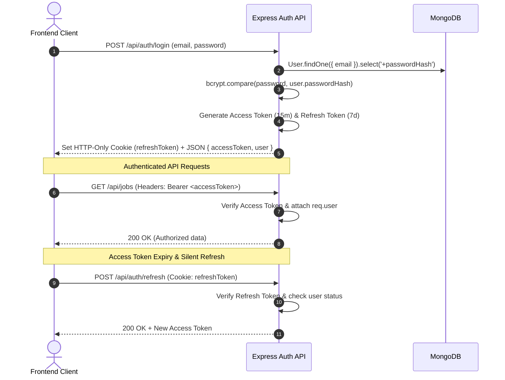

# 🔒 JobPortal 2.0 — Phase 2 Security Baseline & Architecture Specification

**Date:** September 2026  
**Auditor:** Full-Stack & Security Principal Architect  
**Objective:** Production-Grade Authentication, JWT Session Management, RBAC & API Hardening

---

## 1. Baseline Assessment & Vulnerability Analysis

| Domain | Legacy Implementation | Security Vulnerability | Phase 2 Production Target |
| :--- | :--- | :--- | :--- |
| **Password Storage** | Plaintext `password` string in MongoDB | Critical credential leakage risk | Salted `bcryptjs` hash (12 rounds) with `select: false` |
| **User Roles** | `"jobseeker"`, `"employer"` | Arbitrary string, missing `"ADMIN"` role | Normalized roles: `JOB_SEEKER`, `RECRUITER`, `ADMIN` with backward-compatibility aliasing (`jobseeker` -> `JOB_SEEKER`, `employer` -> `RECRUITER`) |
| **Auth APIs** | Only `POST /api/users/register` | No login, token verification, or logout on server | `POST /api/auth/register`, `POST /api/auth/login`, `POST /api/auth/refresh`, `POST /api/auth/logout`, `GET /api/auth/me` |
| **JWT Strategy** | None (client mocked in localStorage) | Insecure mock tokens, no expiration | Short-lived Access Token (15m, Authorization header) + Long-lived HTTP-Only Refresh Token (7d, secure cookie) |
| **Authorization (RBAC)** | None (open mutation endpoints) | Any user can create/delete any job or view any candidate application | Server-side `requireAuth` + `requireRole` middleware with resource ownership validation |
| **Rate Limiting** | None | Vulnerable to brute-force credential stuffing | `express-rate-limit` on `/api/auth/*` (max 10 requests per 15 minutes) |
| **HTTP Headers** | Default Express headers | XSS, MIME sniffing, clickjacking exposure | `helmet` middleware configured with appropriate policies |
| **CORS Policy** | `app.use(cors())` (wildcard) | Open cross-origin requests from any domain | Strict CORS origin whitelist with credentials enabled |

---

## 2. JWT & Token Lifecycle Architecture

---

## 3. Role-Based Access Control (RBAC) Matrix

| Resource / Action | Public / Guest | `JOB_SEEKER` | `RECRUITER` | `ADMIN` |
| :--- | :---: | :---: | :---: | :---: |
| **Browse Jobs & Companies** | ✅ | ✅ | ✅ | ✅ |
| **Submit Job Application** | ❌ | ✅ | ❌ | ❌ |
| **View Own Applications** | ❌ | ✅ | ❌ | ✅ (All) |
| **Post / Update Job** | ❌ | ❌ | ✅ (Own Jobs) | ✅ (All) |
| **View Inbound Applicants** | ❌ | ❌ | ✅ (Own Jobs) | ✅ (All) |
| **Update Applicant Status** | ❌ | ❌ | ✅ (Own Jobs) | ✅ (All) |
| **Access Admin Metrics / Users** | ❌ | ❌ | ❌ | ✅ |

---

## 4. Migration Strategy
1. **Model Upgrades:** Migrate `User` schema to store `passwordHash`, `role` (enum: `JOB_SEEKER`, `RECRUITER`, `ADMIN`), `avatar`, `phone`, `location`, `isVerified`, `isActive`, `lastLoginAt`.
2. **Backward Compatibility:** Support existing `/api/users/register` by routing it to the secure registration controller, maintaining compatibility with existing frontend builds.
3. **Password Migration:** Automatic hashing on update / sign-in for legacy users.
