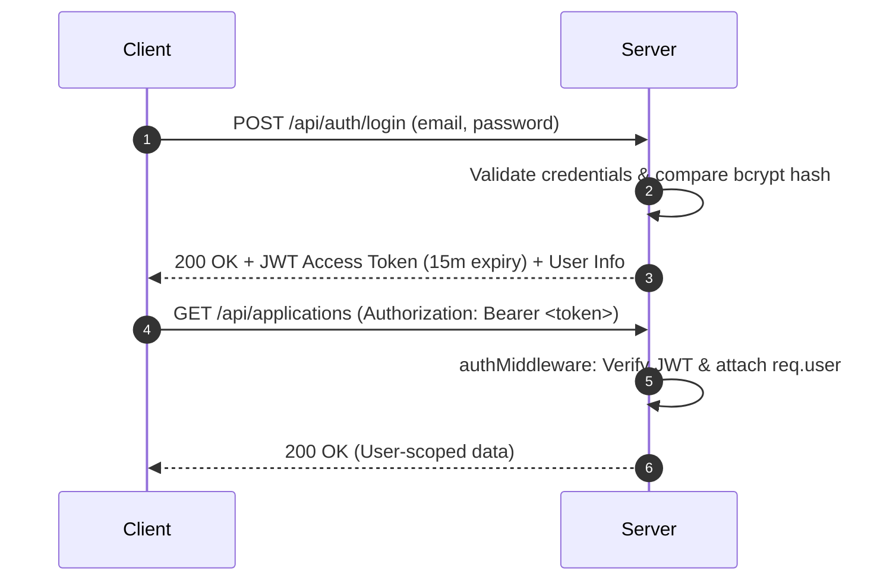

# 🔒 JobPortal 2.0 — Security Audit & Hardening Specification

**Standard:** OWASP Top 10 Compliance • Zero-Trust Role-Based Access Control • Defense in Depth

---

## 1. Vulnerability Assessment Matrix

| Vulnerability / Risk | Severity | Current Status | Remediation in JobPortal 2.0 |
| :--- | :--- | :--- | :--- |
| **Plaintext Passwords** | 🔴 Critical | Stored in plain text | Hash passwords using `bcryptjs` with 12 salt rounds before DB persistence |
| **Missing Authentication on APIs** | 🔴 Critical | Unauthenticated job & application mutation | Enforce JWT token verification on all mutation and private query endpoints |
| **Broken Object Level Auth (BOLA)** | 🔴 Critical | Any user can query any application | Validate that candidates only access own applications and recruiters only access their jobs |
| **NoSQL Query Injection** | 🟠 High | Raw `req.body` fed to Mongoose | Sanitize query inputs using Mongoose schema casting and parameter validation |
| **Cross-Site Scripting (XSS)** | 🟠 High | Unescaped cover notes / bios | React automatic HTML escaping + DOMPurify on markdown/rich content |
| **Brute Force on Auth Endpoints** | 🟠 High | Unlimited login attempts | Implement `express-rate-limit` (max 5 failed attempts per 15 minutes per IP) |
| **Sensitive Data Exposure** | 🟠 High | Password field returned in user JSON | Add `select: false` on password in schema and explicitly strip before response |
| **Missing HTTP Security Headers** | 🟡 Medium | Default Express headers | Mount `helmet` middleware (HSTS, X-Content-Type-Options, X-Frame-Options) |
| **Permissive CORS** | 🟡 Medium | `app.use(cors())` allows all origins | Restrict CORS origin whitelist to trusted frontend domains |

---

## 2. Role-Based Access Control (RBAC) Matrix

| Resource / Action | Public / Guest | Candidate | Recruiter | Platform Admin |
| :--- | :---: | :---: | :---: | :---: |
| **View Jobs & Companies** | ✅ | ✅ | ✅ | ✅ |
| **Apply for Job** | ❌ | ✅ | ❌ | ❌ |
| **Manage Own Profile / Resume** | ❌ | ✅ | ❌ | ❌ |
| **View Own Application Status** | ❌ | ✅ | ❌ | ✅ |
| **Post / Edit / Delete Jobs** | ❌ | ❌ | ✅ (Own Jobs) | ✅ (All Jobs) |
| **View Inbound Applicants** | ❌ | ❌ | ✅ (Own Jobs) | ✅ (All Jobs) |
| **Change Candidate Status** | ❌ | ❌ | ✅ (Own Jobs) | ✅ (All Jobs) |
| **Schedule Interviews** | ❌ | ❌ | ✅ | ✅ |
| **Admin Moderation & Logs** | ❌ | ❌ | ❌ | ✅ |
| **Verify Companies / Suspend Users** | ❌ | ❌ | ❌ | ✅ |

---

## 3. JWT Authentication & Session Hardening

---

## 4. Input Validation & Data Sanitization Standards

1. **Email Sanitization:** Lowercase, trimmed, RFC 5322 regex validation.
2. **Password Policy:** Minimum 8 characters, at least 1 uppercase letter, 1 number, and 1 special character.
3. **URL Validation:** Restrict resume and portfolio links to valid `http://` or `https://` protocols to prevent `javascript:` URI injection.
4. **Number Bounds:** Compensation and experience values strictly validated against minimum and maximum bounds.
